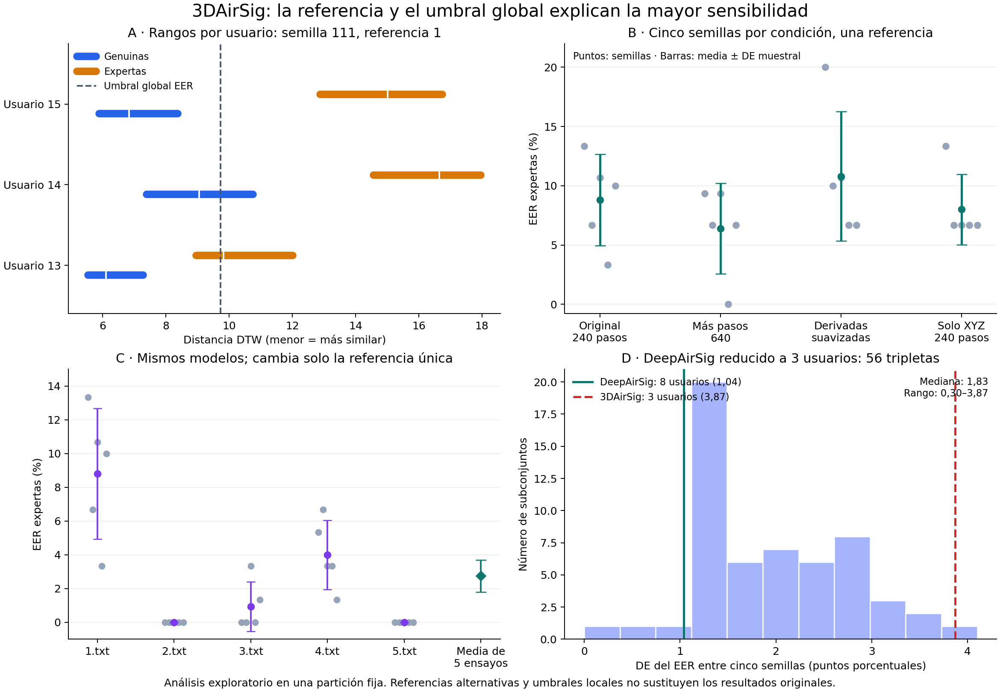

# 3DAirSig pilot validation

Validated on 25 October 2026 in Isard with Python 3.9, PyTorch 2.7.1+cu128,
NumPy 1.26.4 and Numba 0.60.0. The network used CUDA and soft-DTW used CPU.

All nine tests pass, including source immutability, signer-disjoint sampling,
XYZ features, CPU gradients, dynamic batch sizes, DTW/EER fixtures and a
train-save-load-evaluate regression. The wheel builds, installs into a separate
target directory, and reproduces identical evaluation scores outside the checkout.

The real-data run used 600 trajectories, with 12 development signers and three
evaluation signers. It completed 20 epochs, 12 steps per epoch, seed 111, and
evaluated 30 genuine, 75 skilled-forgery and 60 random-forgery probes per
reference-count condition. No raw-file SHA-256 occurs in both signer partitions.
All raw source hashes and the prepared-data hash were verified unchanged.

| References | Skilled EER (%) | Random EER (%) |
| ---: | ---: | ---: |
| 1 | 13.3333 | 0.0000 |
| 4 | 0.0000 | 0.0000 |

These are functional validation results on a small, explicitly defined split.
They do not establish accuracy on a published protocol or on unseen populations.
The aggregate machine-readable summary is [3dairsig-pilot.json](3dairsig-pilot.json).
Raw trajectories, prepared features, score arrays and checkpoints are excluded
from the public repository.

## DeepAirSig pilot validation

Validated on 26 October 2026 using the same Isard runtime and CPU soft-DTW /
CUDA network setup. All 11 tests pass, including both dataset layouts and
rejection of unmatched DeepAirSig signer IDs. Version 0.2.0 builds and installs
as a wheel; evaluation outside the source checkout reproduces identical scores.

The full run uses 1,800 trajectories, development signers 1–32 and held-out
signers 33–40. Seed 111 completed all 20 epochs and 640 optimizer steps.
Each condition evaluates 80 genuine, 200 skilled-forgery and 560 random-forgery
trials. No raw-file hash is shared across development and evaluation partitions.
All 1,800 copied trajectory hashes match the original source ledger. Rechecking
the original I: tree confirms all 1,801 text files (including its README) remain
unchanged. Prepared-data checksums also remain unchanged.

| References | Skilled EER (%) | Random EER (%) |
| ---: | ---: | ---: |
| 1 | 8.0000 | 0.8929 |
| 4 | 3.7500 | 0.5357 |

The aggregate report, including thresholds, configuration and checksums, is
[deepairsig-pilot.json](deepairsig-pilot.json). This is one seed on the explicit
[DsDTW-3D protocol](../docs/deepairsig.md), not an official DeepAirSig benchmark
reproduction. Checkpoints and individual scores remain private.

## Five fresh seeds on both datasets

On 26 October 2026, seeds 111, 222, 333, 444 and 555 were trained from scratch
on **each** dataset. All ten models completed 20 epochs, followed by 20 total
evaluation conditions. The network used CUDA and soft-DTW used CPU. Features,
fixed signer partitions, references, model, optimizer and evaluation are the
same as the pilots. DeepAirSig uses 640 optimizer steps per seed; 3DAirSig uses
240 because its development set is smaller.

EER (%) below is the mean of five separate per-model EERs ± **sample** standard
deviation (`ddof=1`) in percentage points; model scores are not pooled.

| Dataset | References | Skilled mean ± SD | Random mean ± SD | Skilled range |
| --- | ---: | ---: | ---: | ---: |
| DeepAirSig | 1 | 7.8500 ± 1.0398 | 1.0000 ± 0.2396 | 6.2500–8.7500 |
| DeepAirSig | 4 | 3.9500 ± 0.9253 | 0.1071 ± 0.2396 | 3.0000–5.5000 |
| 3DAirSig | 1 | 8.8000 ± 3.8701 | 0.0000 ± 0.0000 | 3.3333–13.3333 |
| 3DAirSig | 4 | 0.5333 ± 1.1926 | 0.0000 ± 0.0000 | 0.0000–2.6667 |

Per-seed EER (%):

| Dataset | Seed | Skilled 1 ref | Skilled 4 refs | Random 1 ref | Random 4 refs |
| --- | ---: | ---: | ---: | ---: | ---: |
| DeepAirSig | 111 | 8.0000 | 3.7500 | 0.8929 | 0.5357 |
| DeepAirSig | 222 | 6.2500 | 3.7500 | 1.2500 | 0.0000 |
| DeepAirSig | 333 | 8.7500 | 3.0000 | 1.2500 | 0.0000 |
| DeepAirSig | 444 | 7.5000 | 3.7500 | 0.7143 | 0.0000 |
| DeepAirSig | 555 | 8.7500 | 5.5000 | 0.8929 | 0.0000 |
| 3DAirSig | 111 | 13.3333 | 0.0000 | 0.0000 | 0.0000 |
| 3DAirSig | 222 | 6.6667 | 0.0000 | 0.0000 | 0.0000 |
| 3DAirSig | 333 | 10.6667 | 2.6667 | 0.0000 | 0.0000 |
| 3DAirSig | 444 | 3.3333 | 0.0000 | 0.0000 | 0.0000 |
| 3DAirSig | 555 | 10.0000 | 0.0000 | 0.0000 | 0.0000 |

DeepAirSig's skilled EER varies by roughly one percentage point across seeds.
3DAirSig with one reference is appreciably less stable: SD 3.87 points and a
ten-point range. Its pilot seed 111 is 4.53 points above the five-seed mean.
With four references, 3DAirSig has four zero-EER seeds and one at 2.67%.
Between-dataset mean differences are 0.95 points (one reference, 3DAirSig higher)
and 3.42 points (four references, DeepAirSig higher). They do not establish
statistical equivalence or superiority: signers, acquisition, training sizes
and trial counts differ. The small 3DAirSig evaluation has only three signers.
Seed stability here concerns one fixed split, not unseen populations.

All 12 tests pass. All 200 epoch records, ten model hashes and 20 evaluations
were checked; EERs were recomputed from the saved scores. Both new seed-111
models reproduce every score from their respective earlier pilots exactly.
All 2,400 trajectory hashes match the original I: source ledgers; re-reading
the 2,402 original text files including READMEs confirms they remain unchanged.
Prepared-data hashes also remain unchanged. Existing pickles were not used.

See [five-seeds.json](five-seeds.json) for complete per-seed aggregates,
thresholds, runtime/code hashes and verification records, and
[the runner guide](../docs/five-seeds.md) to repeat the experiment. Private
checkpoints, data and individual score arrays remain excluded from Git.

## Diagnosing one-reference variation in 3DAirSig

The [diagnosis](../docs/3dairsig-diagnosis.md) tests reference choice, user
composition, 640-step training, smoothed derivatives and XYZ-only input.
Fifteen additional models completed 20 epochs each; 30 evaluation conditions
and all 300 epoch records were verified. The original feature extractor,
training engine, models and reported five-seed results remain unchanged.

The dominant observed mechanism is cross-user score alignment under a global
threshold and an arbitrary first reference, amplified by only three evaluation
users. Individual-user EER is zero for every seed, while pooled EER varies.
The first-reference case is 8.80 ± 3.87%; averaging five predetermined single-
reference trials yields 2.75 ± 0.94%. More training yields 6.40 ± 3.82%, so it
does not remove the dispersion. Smoothing derivatives worsens it.

All 2,400 baseline feature tensors regenerate bit for bit from the raw text;
all 2,402 original TXT files including READMEs were checked unchanged. See the
[aggregate report](3dairsig-diagnosis.json) for the reference combinations,
user-subset results, interventions and integrity checks. Local EER and reference
alternatives are exploratory diagnostics, not test-calibrated replacements
for the original benchmark metric.

All 14 tests pass. Original checkpoint hashes remain unchanged and paired
feature interventions use identical sampled batches to the baseline.

